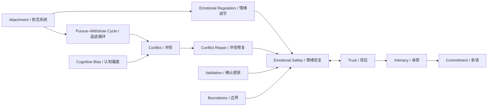

# 概念知识图谱

构建命令会把所有 `[[wikilinks]]` 提取到 `index/graph.json`。下面的图是人为维护的高层导航，不声称箭头都是单向因果。

## 核心链路

- [[Concepts/Attachment|依恋]] → [[Concepts/Emotional-Regulation|情绪调节]] → [[Concepts/Emotional-Safety|情绪安全]]。
- [[Concepts/Trust|信任]] ↔ [[Concepts/Intimacy|亲密]] ↔ [[Concepts/Commitment|承诺]]。
- [[Concepts/Criticism|批评]]、[[Concepts/Defensiveness|防御]]、[[Concepts/Contempt|轻蔑]]、[[Concepts/Stonewalling|冷处理/筑墙]]可能维持冲突升级；[[Concepts/Conflict-Repair|冲突修复]]和[[Concepts/Validation|确认感受]]是可观察的替代过程。
- [[Concepts/Boundaries|边界]]与连接并不天然对立；边界可以使同意、自治与安全更清晰。

## 非因果提醒

知识图谱边表达“概念有关联/被共同讨论”，除非边的来源卡明确说明研究设计，否则不能读成因果关系。

